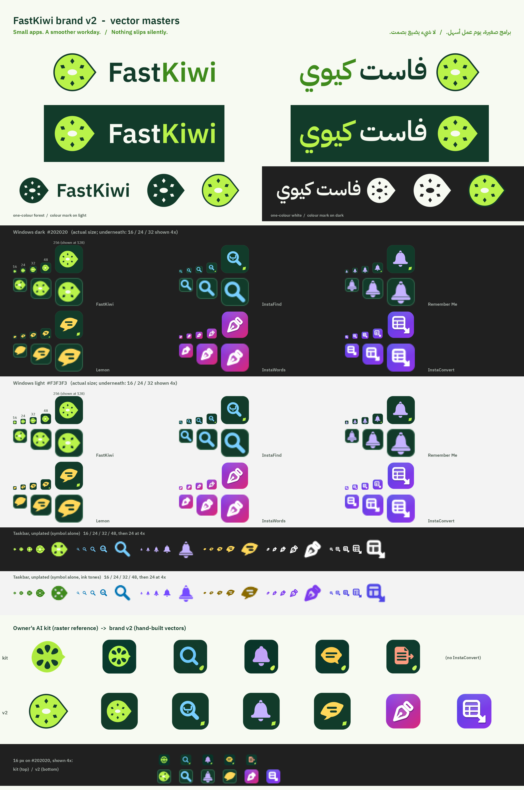

# هوية FastKiwi — الإصدار الثاني (brand v2)

ملفات متجهية (SVG) رُسمت يدوياً بالكود، بألوان مسطّحة بلا تدرّج ولا ظل. هي النسخة الأصلية التي
تُستخرج منها كل الصور والأيقونات. الحزمة التي أُنشئت بالذكاء الاصطناعي كانت مرجعاً للفكرة فقط،
ولم يُنسخ منها أو يُتتبَّع أي جزء، ولا تُوزَّع صورها.

> هذا المجلد لا يغيّر أي صفحة في الموقع. لا شيء هنا مستعمل في الصفحات بعد.



> **قرار صاحب المشروع (2026-11-06):** Lemon وInstaFind يبقيان على أيقونتيهما القديمتين. لذلك لا تُستعمل
> أيقونتا brand v2 لهذين التطبيقين (`icons/lemon/` و`icons/instafind/`، وما يظهر لهما في المعاينة أعلاه)
> في الموقع ولا في التطبيقين. الملفات باقية هنا للأرشيف فقط.

> **قرار صاحب المشروع D-049 (2026-11-09):** InstaWords وInstaConvert يأخذان أيقونتين جديدتين بأسلوب
> أيقونة InstaFind: مربّع مدوّر بتدرّج قُطري، ولمعة خفيفة في الأعلى، وظلّ ناعم للرمز، ورمز أبيض كبير
> بتعبئة شفّافة. InstaWords: سنّ قلم، بنفسجي ← وردي `#7c3aed` ← `#db2777`. InstaConvert: جدول بسهم
> تحويل، نيلي ← أرجواني `#4f46e5` ← `#9333ea`. مصدرهما `source/insta.py` (الرسم المعتمد كما هو، مع
> تنظيف بسيط وتوسيط الرمز)، وكل ملفات `icons/instawords/` و`icons/instaconvert/` مولّدة منه. لذلك
> لا تنطبق عليهما قواعد البلاطة الخضراء وبذرة التوقيع أدناه، وصفّاهما في الجداول أدناه للتصميم الجديد.

## الفكرة

- **رمز FastKiwi:** شريحة كيوي لها رأس واحد يتّجه إلى اليمين. بذورها نِقاط عربية على شكل معيّن
  (مثل نقطة الخط العربي)، وفي وسطها قلب فاتح. **الرأس لا يُقلب أبداً،** ولا في التصميم العربي.
- **عائلة التطبيقات:** بلاطة خضراء داكنة (forest) تملأ الأيقونة كلها، زواياها مدوّرة بنسبة 22٪،
  وفيها رمز التطبيق بلونه، وفي الركن الأيمن السفلي «بذرة» ليمونية على شكل نقطة عربية (توقيع العائلة).
  أيقونة FastKiwi نفسها بلا بذرة التوقيع.

| التطبيق | الرمز | اللون |
|---|---|---|
| FastKiwi | شريحة الكيوي | ليموني `#B9F34A` |
| InstaFind | عدسة بحث في داخلها «ب» (من 41 بكسل فأكبر) | سماوي `#78CFFF` |
| Remember Me | جرس | خزامي `#C5B3FF` |
| Lemon | فقاعة كلام على شكل ليمونة: بيضاوية مائلة بطرفين بارزين، تختلف عن دائرة الكيوي | أصفر `#FFD85A` |
| InstaWords (D-049) | سنّ قلم مائل 45°، أبيض بتعبئة شفّافة، على تدرّج بأسلوب InstaFind | تدرّج `#7c3aed` ← `#db2777` |
| InstaConvert (D-049) | جدول (عنوان وصفّان وعمود) بسهم تحويل، أبيض على تدرّج بأسلوب InstaFind | تدرّج `#4f46e5` ← `#9333ea` |

## الملفات

| المسار | ماذا فيه |
|---|---|
| `logo/mark.svg` | الرمز بالألوان. حافته خضراء داكنة، فيُرى على الفاتح والداكن |
| `logo/mark-small.svg` | الرمز مبسّطاً (4 بذور أكبر) لأحجام 16–32 بكسل |
| `logo/mark-mono-forest.svg`، `logo/mark-mono-white.svg` | الرمز بلون واحد (البذور والقلب مفرّغة) |
| `logo/fastkiwi-latin.svg` | «FastKiwi»: الرمز يساراً والاسم يمينه، للخلفية الفاتحة |
| `logo/fastkiwi-arabic.svg` | «فاست كيوي»: الرمز يميناً (بداية القراءة) والاسم يساره، للخلفية الفاتحة |
| `logo/fastkiwi-*-on-forest.svg` | النسخة المعكوسة على خلفية forest (الخلفية جزء من الملف) |
| `logo/fastkiwi-*-mono-forest.svg`، `logo/fastkiwi-*-mono-white.svg` | الشعار بلون واحد |
| `logo/png/` | كل ما سبق PNG: الشعارات بعرض 1600، والرمز بارتفاع 64 و512 |
| `icons/<app>/<app>.svg` | الأيقونة الكاملة (256) مع بذرة التوقيع. لـ InstaWords وInstaConvert: الرسم المعتمد (شبكة 1024) |
| `icons/<app>/<app>-16/20/24/32.svg` | نسخ صغيرة مضبوطة يدوياً على شبكة البكسل، **بلا بذرة**. لـ InstaWords وInstaConvert: بلا ظلّ، وبلاطة تملأ الصورة، وخطوط أعرض، وتفاصيل أقل في 16 و20 |
| `icons/<app>/png/` | PNG بالأحجام 16، 20، 24، 32، 40، 48، 64، 96، 128، 256، 512 |
| `icons/<app>/<app>.ico` | أيقونة ويندوز: 16، 20، 24، 32، 40، 48، 64، 96، 128، 256 (الأحجام الصغيرة من النسخ اليدوية) |
| `icons/<app>/msix/` | صور حزمة MSIX للمتجر (التفاصيل أدناه) |
| `preview.png` | لوحة المعاينة: الشعاران، وكل الأيقونات بالأحجام 16/24/32/48/256 على خلفية داكنة وفاتحة، وأيقونات شريط المهام (الرمز وحده)، ومقارنة مع حزمة صاحب المشروع |
| `source/gen.py`، `source/export.py` | السكربتان اللذان يولّدان كل شيء |
| `source/insta.py` | رسم أيقونتي InstaWords وInstaConvert (D-049)، يستعمله السكربتان |

`<app>` واحد من: `fastkiwi`، `instafind`، `remember-me`، `lemon`، `instawords`، `instaconvert`.

### أي رسم يُستعمل في أي حجم

| الحجم | الرسم |
|---|---|
| 16–17 | شبكة 16 |
| 18–21 | شبكة 20 |
| 22–27 | شبكة 24 |
| 28–40 | شبكة 32 |
| 41 فأكبر | الرسم الكامل مع بذرة التوقيع (و«ب» في عدسة InstaFind) |

في كل الأحجام حافة أفتح بعرض بكسل واحد (`#2F6249`) حول البلاطة، حتى تبقى ظاهرة على الخلفيات
الداكنة مثل `#202020`. (InstaWords وInstaConvert بلا هذه الحافة: تدرّجهما ظاهر على الخلفيتين.)

### صور MSIX (لكل تطبيق 62 ملفاً)

- `Square44x44Logo.scale-100/125/150/200/400.png` (44، 55، 66، 88، 176 بكسل).
- `Square44x44Logo.targetsize-N.png` بالأحجام 16، 20، 24، 30، 32، 36، 40، 48، 60، 64، 72، 80، 96، 256،
  وكل حجم بثلاث نسخ (قرار صاحب المشروع: شريط المهام يعرض **الرمز وحده بلا بلاطة**، بأسلوب ويندوز 11):
  - بلا لاحقة (plated): البلاطة، لقائمة ابدأ وقائمة التطبيقات؛
  - `_altform-unplated` لشريط المهام الداكن: الرمز وحده بلونه، والتفاصيل الداكنة داخله (البذور،
    وخطوط الليمونة، وأشرطة الشيك، وفواصل الجدول) مفرّغة؛
  - `_altform-lightunplated` لشريط المهام الفاتح: الرمز وحده بدرجة «حبر» داكنة من لونه (الجدول أدناه)،
    لأن الألوان الفاتحة لا تُرى على الخلفية الفاتحة.
- InstaWords وInstaConvert (D-049): `_altform-unplated` هو الرمز الأبيض وحده، و`_altform-lightunplated`
  هو الرمز بلون بداية التدرّج (`#7c3aed` بنسبة 5.14:1 و`#4f46e5` بنسبة 5.67:1 على `#F3F3F3`).
- البلاطة تبقى في صور المتجر وقائمة ابدأ: `Square44x44Logo.scale-*` و`Square150x150Logo` و`Wide310x150Logo` و`StoreLogo`.
- `Square150x150Logo`، `Wide310x150Logo`: الأيقونة بنصف الارتفاع، فوق المنتصف قليلاً ليتّسع اسم التطبيق.
- `StoreLogo` (50 بكسل × المقياس).
- الأسماء تطابق ما يستعمله فرع متجر InstaWords (`make-assets.py`)، فالاستبدال يكون بنسخ الملفات
  فوق القديمة **بنفس الأسماء**، دون تغيير أي اسم ملف أو هوية حزمة.

## طريقة الاستعمال

- **المساحة الفارغة:** ربع ارتفاع الرمز (X = ¼ قطر الكيوي) من كل جهة. ملفات الشعارات فيها هذه
  المساحة مسبقاً.
- **أصغر حجم:** الرمز 16 بكسل (`mark-small` أو أيقونة شبكة 16)، والشعار اللاتيني بعرض 120 بكسل،
  والعربي بعرض 140 بكسل. أصغر من ذلك: استعمل الرمز وحده.
- **العربية:** الرمز على اليمين والاسم على يساره. رأس الكيوي يبقى متّجهاً إلى اليمين.
- **الألوان على الفاتح:** النص بالأخضر الداكن forest. كلمة Kiwi / «كيوي» بأخضر الورقة `#3F8A1C`،
  ولا يُكتب بالليموني أو بأي لون من ألوان التطبيقات على خلفية فاتحة (التباين أقل من 2:1، انظر الجدول).
- **ألوان التطبيقات** للرموز والتعبئة على forest فقط، لا للنصوص ولا للخطوط الرفيعة على الصفحة الفاتحة.
- **لا تفعل:** لا تقلب الرمز، لا تمدّه أو تضغطه، لا تغيّر الألوان، لا تضف ظلاً أو تدرّجاً أو إطاراً،
  لا تضع بذرة التوقيع في أيقونة FastKiwi نفسها، ولا تضعها في الأحجام 32 بكسل فأقل.
- **في المتاجر والمواقع:** ضع اسم التطبيق الحقيقي بجانب أيقونته. في أول ذكر تسويقي:
  "InstaFind by FastKiwi" وما يشبهها.

## الألوان وجدول التباين (WCAG 2.x)

| الاسم | HEX | الاستعمال |
|---|---|---|
| forest | `#123B2A` | البلاطات، النص على الفاتح، البذور |
| ليموني الكيوي | `#B9F34A` | لحم الكيوي، بذرة التوقيع، «Kiwi» على الداكن |
| أبيض دافئ | `#F7FAF2` | الخلفية الفاتحة، النص على forest، قلب الكيوي |
| أخضر الورقة | `#3F8A1C` | «Kiwi» / «كيوي» على الفاتح فقط (نص كبير) |
| حافة البلاطة | `#2F6249` | الحافة الأفتح (بكسل واحد) |
| InstaFind | `#78CFFF` | |
| Remember Me | `#C5B3FF` | |
| Lemon | `#FFD85A` | |
| InstaWords (D-049) | `#7c3aed` ← `#db2777` | تدرّج، لا لون نص |
| InstaConvert (D-049) | `#4f46e5` ← `#9333ea` | تدرّج، لا لون نص |

النسب محسوبة بمعادلة WCAG 2.x (relative luminance). AA للنص العادي 4.5:1، وللنص الكبير
والرسوم 3:1.

| اللون الأمامي | الخلفية | النسبة | النتيجة |
|---|---|---|---|
| forest `#123B2A` | أبيض دافئ `#F7FAF2` | 11.82:1 | AAA |
| forest `#123B2A` | أبيض `#FFFFFF` | 12.46:1 | AAA |
| أبيض دافئ `#F7FAF2` | forest | 11.82:1 | AAA |
| ليموني `#B9F34A` | forest | 9.49:1 | AAA |
| أخضر الورقة `#3F8A1C` | أبيض دافئ | 4.09:1 | AA للنص الكبير فقط (الشعار) |
| أخضر الورقة `#3F8A1C` | أبيض | 4.32:1 | AA للنص الكبير فقط |
| سماوي `#78CFFF` | forest | 7.22:1 | AAA |
| خزامي `#C5B3FF` | forest | 6.69:1 | AA (AAA للكبير) |
| أصفر `#FFD85A` | forest | 9.04:1 | AAA |
| ليموني `#B9F34A` | أبيض دافئ | 1.25:1 | يفشل: لا يُستعمل على الفاتح |
| سماوي / خزامي / أصفر | أبيض دافئ | 1.64 / 1.77 / 1.31 | يفشل: لا تُستعمل على الفاتح |
| بلاطة forest | شريط مهام داكن `#202020` | 1.31:1 | الحافة لا تُرى، لذلك أُضيفت الحافة الأفتح |
| الحافة `#2F6249` | شريط مهام داكن `#202020` | 2.30:1 | حدّ البلاطة ظاهر وخفيف |
| بلاطة forest | شريط مهام فاتح `#F3F3F3` | 11.23:1 | ممتاز |

درجات «الحبر» لشريط المهام الفاتح (`altform-lightunplated`)، كلها 4.5:1 أو أكثر على `#F3F3F3`
ما عدا أخضر الورقة (3.89:1، أكثر من 3:1 المطلوبة للرسوم):

| التطبيق | اللون | الحبر | على `#F3F3F3` | اللون الأصلي على `#202020` |
|---|---|---|---|---|
| FastKiwi | `#B9F34A` | `#3F8A1C` | 3.89:1 | 12.40:1 |
| InstaFind | `#78CFFF` | `#0073B3` | 4.61:1 | 9.44:1 |
| Remember Me | `#C5B3FF` | `#754AFF` | 4.53:1 | 8.74:1 |
| Lemon | `#FFD85A` | `#8A6A00` | 4.57:1 | 11.81:1 |
| InstaWords (D-049) | أبيض | `#7c3aed` | 5.14:1 | الأبيض 16.29:1 |
| InstaConvert (D-049) | أبيض | `#4f46e5` | 5.67:1 | الأبيض 16.29:1 |

(`#202020` و`#F3F3F3` تقريب لألوان شريط مهام ويندوز 11 الداكن والفاتح.)

## الشعارات النصية (taglines)

| أين | العربية | English |
|---|---|---|
| الموقع | «برامج صغيرة، يوم عمل أسهل.» | "Small apps. A smoother workday." |
| المتجر والتطبيقات | «لا شيء يضيع بصمت.» | "Nothing slips silently." |

السطر الثاني وعدٌ بأن لا شيء يمرّ **بصمت**، لا وعدٌ بأن لا أخطاء. لا تحوّله إلى ادعاء دقّة.

## الخطوط والترخيص

- اللاتيني: IBM Plex Sans SemiBold. العربي: IBM Plex Sans Arabic SemiBold.
  الخطّان بترخيص SIL Open Font License 1.1 (حزم IBM الرسمية `@ibm/plex-sans` و`@ibm/plex-sans-arabic` 1.1.0).
- كل النصوص حُوّلت إلى مسارات (paths)، فلا يحتاج أي ملف إلى خط، ولا يُوزَّع ملف خط هنا.
- «ب» في عدسة InstaFind مرسومة يدوياً (قوس ونقطة على شكل معيّن)، لا من خط.
- الرسوم أصلية، صُنعت بالكود من أشكال هندسية محسوبة.

## إعادة التوليد

```sh
pip install fonttools uharfbuzz cairosvg Pillow
python3 brand/source/gen.py <fonts-dir> brand          # كل ملفات SVG
python3 brand/source/export.py <fonts-dir> brand <work-dir> [<owner-kit-dir>]   # PNG وICO وMSIX وpreview.png
```

`<fonts-dir>` فيه `IBMPlexSans-SemiBold.woff` و`IBMPlexSansArabic-SemiBold.woff`
(من مجلد `fonts/complete/woff` في حزم npm المذكورة). `<owner-kit-dir>` اختياري، ويُستعمل فقط لشريط المقارنة في
المعاينة.

---

## English

> **Owner decision (2026-11-06):** Lemon and InstaFind keep their legacy icons, so the brand v2 masters for
> those two apps (`icons/lemon/`, `icons/instafind/`, and their tiles in `preview.png`) are not used on the site
> or in the apps. The files stay here for reference only.
>
> **Owner decision D-049 (2026-11-09):** InstaWords and InstaConvert get new icons in InstaFind's style: a
> diagonal gradient rounded square, a soft top highlight, a soft glyph shadow and one large white glyph with a
> translucent fill. InstaWords: pen nib, violet→pink `#7c3aed`→`#db2777`. InstaConvert: table with a convert
> arrow, indigo→purple `#4f46e5`→`#9333ea`. Source: `source/insta.py` (the approved masters unchanged except a
> small tidy and a centred glyph); every file in `icons/instawords/` and `icons/instaconvert/` is generated from
> it. `<app>.svg` is the 1024 master; the 16–32 px drawings drop the shadow, fill the canvas and use thicker
> strokes (16/20 px also drop inner details). Taskbar: `_altform-unplated` is the white glyph alone,
> `_altform-lightunplated` the glyph in the gradient's start colour (5.14:1 / 5.67:1 on #F3F3F3). The forest
> tile, seed and edge rules below do not apply to these two apps.

**FastKiwi brand v2**: hand-built flat vector masters (SVG generated by `source/gen.py`) plus every raster
export (`source/export.py`). The owner's AI-generated kit was a concept reference only; nothing was traced
or copied from it, and its files are not shipped. This folder changes no live page.

- **Parent mark:** a kiwi slice with one forward point to the right (never mirrored, also not in Arabic
  layouts), a pale core, and seeds drawn as Arabic nuqta rhombi. A forest rim keeps it visible on light
  backgrounds.
- **Lockups:** Latin "FastKiwi" (mark left), Arabic «فاست كيوي» (mark right, where Arabic reading starts),
  each in colour, reversed on forest, and one-colour forest / white.
- **App icons:** a forest tile that fills 100 % of the canvas, corner radius 22 %, a lime nuqta seed at the
  lower right (not on FastKiwi itself). InstaFind: magnifier with «ب»; Remember Me: bell; Lemon: lemon-shaped
  speech bubble. (InstaWords and InstaConvert: see D-049 above.)
- **Small sizes:** hand-tuned 16/20/24/32 px drawings without the seed (used up to 40 px), all with a 1 px
  lighter tile edge `#2F6249` (2.30:1 on a #202020 taskbar; the plain forest tile is 1.31:1).
- **Exports per app:** PNG 16–512, a multi-size ICO (16–256; BMP frames below 256, PNG at 256) and the MSIX
  set (Square44x44 at scale-100…400 and targetsize-16…256 plated / `altform-unplated` / `altform-lightunplated`,
  Square150x150, Wide310x150, StoreLogo), named like InstaWords' existing Store assets.
- **Taskbar (owner's decision):** `targetsize-*_altform-unplated` is the symbol alone (Windows 11 unplated
  style) in its accent colour, with the dark inner details cut out; `_altform-lightunplated` uses ink tones
  (≥ 4.5:1 on #F3F3F3, leaf green 3.89:1). The plated tile stays for Start and the Store (`targetsize-*`
  without suffix, `scale-*`, Square150x150, Wide310x150, StoreLogo).
- **Clear space:** ¼ of the mark height on every side. **Minimum:** mark 16 px, Latin lockup 120 px wide,
  Arabic lockup 140 px wide.
- **Taglines:** site «برامج صغيرة، يوم عمل أسهل.» / "Small apps. A smoother workday."; Store and apps
  «لا شيء يضيع بصمت.» / "Nothing slips silently."
- **Contrast:** see the table above (WCAG 2.x). Accents and lime are for fills on forest only; on light
  backgrounds use forest text, and leaf green `#3F8A1C` only for large text such as the wordmark.
- **Fonts:** IBM Plex Sans / IBM Plex Sans Arabic SemiBold (SIL OFL 1.1), outlined to paths; no font files ship.
